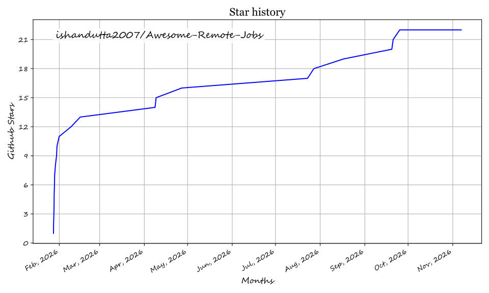

# 🏝️ Awesome Remote Jobs - Curated Directory of Remote-Friendly Tech Companies

  

  
  
  
  
  

---

## 📖 Introduction & Overview

Welcome to **Awesome Remote Jobs** (powered by **Remote in Tech**), the definitive, community-curated list of semi to fully remote-friendly companies and job search platforms in the tech industry. Whether you are searching for your next high-impact remote software engineering position, product management role, AI/ML opportunity, or flexible work-from-anywhere career, this repository aggregates trusted resources and vetted opportunities.

This project is built with [Eleventy](https://www.11ty.dev/) and is continuously maintained as an open community-driven resource.

---

## 🚀 The Live Website

While this repository contains the source dataset and curated directories, you can explore the complete interactive directory and company profiles on the web:

👉 **[Visit RemoteInTech.company](https://remoteintech.company/?utm_campaign=GitHub+README&utm_source=github&utm_medium=readme&utm_content=textlink)** 🌐

---

## 🔍 SEO & Discovery Keywords

To help tech professionals, job seekers, and recruiters find these opportunities across Bing, Google, DuckDuckGo, and other search engines, here are our target focus areas:

* 🌍 **remote jobs** &amp; **remote tech jobs**
* 🏡 **work from home jobs** &amp; **work from anywhere**
* 🏢 **fully remote companies** &amp; **remote-first startups**
* 💻 **remote software engineering jobs** &amp; **remote developer jobs**
* 👥 **distributed teams** &amp; **async remote work culture**
* 📡 **telecommute jobs** &amp; **remote-friendly companies**
* 🤖 **remote AI, ML & robotics jobs**

---

## 🌐 Remote Job Boards & Aggregators

Here are some of the most reliable and active platforms to find remote-friendly tech jobs:

* 🎯 **[Dynamite Jobs](https://dynamitejobs.com/)**: Handpicked, vetted remote positions across engineering, product, marketing, and operations.
* 🛡️ **[FlexJobs](https://www.flexjobs.com/)**: A subscription-based service that pre-screens remote and flexible jobs.
* 🤝 **[Hired](https://hired.com/)**: Companies apply to you for tech and engineering roles.
* ☕ **[Jobspresso](https://jobspresso.co/)**: Expertly curated remote careers in tech, marketing, customer support, and more.
* ⚡ **[JS Remotely](https://jsremotely.com/)**: Remote JavaScript, TypeScript, React, Node.js, and frontend/fullstack developer jobs.
* 💼 **[LinkedIn](https://www.linkedin.com/jobs/remote-jobs/)**: Use the "Remote" filter to find verified opportunities globally.
* 🗺️ **[Nodesk](https://nodesk.co/remote-jobs/)**: A curated collection of remote jobs, digital nomad resources, and remote company profiles.
* 🔎 **[Otta](https://otta.com/)**: A highly personalized job search platform tailored for modern tech roles.
* 🚀 **[Remote OK](https://remoteok.com/)**: One of the most popular remote job boards for developers, designers, and tech talent.
* 📋 **[Remote.co](https://remote.co/remote-jobs/)**: Hand-curated list of remote jobs and distributed team resources.
* 🛸 **[RemoteRocketship](https://www.remoterocketship.com/)**: Automatically aggregates thousands of remote jobs directly from company career sites.
* 💡 **[Remotive](https://remotive.com/)**: Hand-screened remote tech, design, sales, and product jobs.
* 🤖 **[RobotTraining.jobs](https://robottraining.jobs/remote-robot-training-jobs)**: Remote robot-training work (teleoperation, demonstration recording, at-home video capture) from robotics employers, with posted pay.
* 🌎 **[We Work Remotely](https://weworkremotely.com/)**: The largest remote work community in the world.
* 🦄 **[Wellfound (formerly AngelList)](https://wellfound.com/jobs)**: Great for finding roles in high-growth startups.
* 🧳 **[Working Nomads](https://www.workingnomads.com/jobs)**: Curated lists of remote jobs for modern digital nomads and traveling professionals.
* 📋 **[Jaabz](https://jaabz.com/)**: Tech jobs with visa sponsorship, relocation, and remote filters.
* ⛓️ **[chainjobs.app](https://chainjobs.app/)**: Free Web3 and freelance job board where clients post jobs, freelancers offer services, and both sides chat directly; payment in crypto or bank transfer, 0% platform commission.

---

## 🔥 Featured Remote Openings

| Company | Role | Category | Apply Link |
| :--- | :--- | :--- | :--- |
| **Automattic** | Senior Code Wrangler (Backend/WordPress) | 🛠️ Backend | [Apply ↗️](https://automattic.com/work-with-us/) |
| **Calendly** | Senior Full Stack Engineer | 💻 Fullstack | [Apply ↗️](https://calendly.com/careers) |
| **Canonical** | Software Engineer (Ubuntu / Cloud) | ☁️ Systems/Cloud | [Apply ↗️](https://canonical.com/careers) |
| **Foundation AI** | Senior Software Engineer | 🤖 AI/Infra | [Apply ↗️](https://foundation.ai/careers) |
| **Fox Corporation** | Software Developer (PWA/Video) | 🎨 Frontend | [Apply ↗️](https://www.foxcareers.com/) |
| **GitLab** | Senior Backend Engineer | 🛠️ Backend | [Apply ↗️](https://about.gitlab.com/jobs/) |
| **Propel** | Staff Software Engineer (Fullstack) | 💻 Fullstack | [Apply ↗️](https://www.propel.run/careers) |
| **Signifyd** | Software Engineer (Decisioning) | 🛠️ Backend | [Apply ↗️](https://www.signifyd.com/careers/) |
| **Stripe** | Staff Software Engineer (Infrastructure) | 🏗️ Infra/Platform | [Apply ↗️](https://stripe.com/jobs) |
| **Supabase** | Fullstack Engineer | 💻 Fullstack | [Apply ↗️](https://supabase.com/careers) |
| **Vetcove** | Staff Frontend Engineer | 🎨 Frontend | [Apply ↗️](https://www.vetcove.com/careers/) |

---

## 🤝 How to Contribute

This list is maintained by the open-source community, and we warmly welcome contributions! If you know of a remote-friendly company or job platform that isn't on our list, please consider adding it.

To contribute, please read our [**Contributing Guide**](.github/CONTRIBUTING.md) for instructions on how to add new companies or update existing information.

---

## 💖 Support & Sponsorship

Thank you so much for using and supporting this repository! ❤️

If this project helps you on your remote job search journey or if you find value in these curated resources, please consider:
- ⭐ **Starring** this repository to help others discover it
- 🍴 **Forking** and contributing new remote-friendly companies
- 📢 **Sharing** it with friends, colleagues, and remote communities
- ☕ **Buying a coffee / Sponsoring** the maintainer via the [GitHub Sponsor Dashboard](https://github.com/sponsors/ishandutta2007)

---

## 📈 Star History

---

## 📜 License

This project is licensed under the ISC License - see the [LICENSE](LICENSE) file for details.

---

## 🙏 Acknowledgements

A big thank you to **Lene Saile** for the incredible [Eleventy Excellent](https://github.com/madrilene/eleventy-excellent) starter project that this site is built upon.

## ⭐ Star History

<a href="https://star-history.com/#ishandutta2007/Awesome-Remote-Jobs&Timeline" align="center">
  <picture>
    <source media="(prefers-color-scheme: dark)" srcset="assets/ishandutta2007_Awesome-Remote-Jobs_growth.svg">
    
  </picture>
</a>
